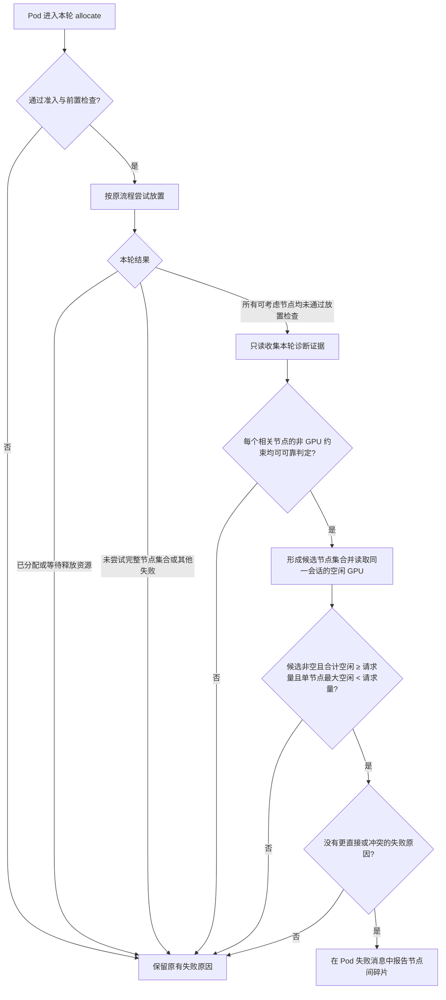

# Pending GPU 作业的节点间碎片化诊断设计

> 状态：设计草案（尚未实现）
>
> 依据：[需求与开发计划](gpu-pending-fragmentation-diagnosis-zh.md)
>
> 范围：Volcano 调度器；首版仅诊断单个 Pod 的整卡 `nvidia.com/gpu` 请求

> 实施拆分：[开发计划](gpu-pending-fragmentation-development-plan-zh.md)

## 1. 目标与结论含义

当一个 Pod 在本轮调度中未能放置时，调度器可在证据充分的情况下指出：**符合该 Pod 其他放置约束的节点，合计有足够的空闲 GPU，但每个节点的空闲 GPU 都少于该 Pod 的请求量。** 这是对本轮放置失败的解释，不是对物理 GPU 使用率的测量，也不表示这些空闲卡可以跨节点供同一个 Pod 使用。

诊断只补充已有调度失败信息。它不参与节点过滤、排序、抢占、迁移或绑定，也不改变 PodGroup 的就绪判定。

## 2. 整体流程



诊断发生在正常放置尝试失败之后、失败原因写入之前。它使用该次尝试所依据的调度会话及节点资源视图；如果会话内已经发生其他任务的试探性分配，以**该 Pod 被检查时**的资源状态为准，不在稍后的状态更新阶段重新读取实时 Node。诊断计算产生的证据只供本轮使用，下一轮重新判断。

### 2.1 进入条件

- Pod 由 Volcano 管理，处于 Pending，实际进入本轮 `allocate` 的节点放置检查；GPU 请求是正整数整卡 `nvidia.com/gpu`。
- 队列准入、调度门、PodGroup 前置条件及 Pod 级前置检查已经通过。未被选择尝试的 Pod 不输出本诊断。
- 正常流程没有为该 Pod 找到可立即分配或可等待资源释放的节点，也没有将其判定为已具备单 Pod 放置条件、仅等待 Gang 就绪。
- 需要诊断的节点范围与本轮该 Pod 实际允许考虑的范围一致，包括拓扑域和调度分片等限制；不能用全群节点空闲量解释局部候选集的失败。

### 2.2 候选节点与证据

对上述节点范围内的每个节点，先回答：**如果只忽略 `nvidia.com/gpu` 的当前容量不足，该节点是否满足这个 Pod 的其他放置要求？** 其他要求包括节点选择、亲和性、污点容忍、CPU／内存、Pod 数量、其他资源及启用的调度策略。回答必须与本轮调度采用的约束语义一致。

只有得到可靠“是”的节点才进入候选集合。可靠“否”的节点排除。若任一相关节点因为提前返回、插件错误、缓存或不支持的自定义约束而无法可靠回答，则本轮不作确定的碎片诊断。尤其不能把普通谓词的 `Insufficient nvidia.com/gpu` 结果直接当作“其他约束均已通过”的证据：当前资源检查会先于后续谓词返回。诊断需要一条**只读、完整且可核对的非 GPU 约束评估路径**；实现前须列出首版实际支持的谓词／插件组合，对未覆盖的组合回退到原有原因。不通过改写 Pod 请求或节点容量来影响正常调度状态。

节点检查必须覆盖该 Pod 的完整相关范围，不能仅依赖为正常调度提速而提前结束的节点采样结果。若出现节点视图缺失、检查中止或预算不足，也视为证据不完整。诊断不得为了收集证据而改变原有过滤结果。

### 2.3 碎片判定

设单 Pod 请求量为 `R`，候选节点为 `C`，节点 `i` 在该 Pod 检查时立即可用的整卡数为 `Fi`。仅当以下条件**同时成立**才给出结论：

1. `C` 非空，所有 `Fi` 均来自同一轮放置视图，且是可验证的非负整卡数；
2. `sum(Fi) >= R`；
3. `max(Fi) < R`；
4. 没有节点通过完整放置检查，也没有其他已知原因更直接地解释本轮失败。

采用当前空闲量，不把 `FutureIdle`、正在释放的资源、抢占后的潜在容量或 Node `Allocatable` 算为空闲卡。`FutureIdle` 可以让正常流程选择等待释放资源；发生这种情况时，沿用等待原因，不报告“当前空闲卡碎片”作为失败结论。GPU 数值来自 Volcano 对该扩展资源的调度账本，不来自设备利用率或显存指标。

例如三个已确认满足其他约束的节点分别空闲 1、2、1 张，`R=4`，则 `sum=4`、`max=2`，可以报告节点间碎片。若合计为 3，则是容量不足；若某节点空闲 4 张，放置仍失败，则继续查明其他原因，均不贴碎片标签。

## 3. 输出与现有原因的关系

确定命中时，只在该 Pod 已有的 `PodScheduled=False` 条件及 `FailedScheduling` 事件的消息中说明请求量、候选节点数量、合计空闲量和单节点最大空闲量。Pod 条件的 `Reason` 保持 `Unschedulable`，事件的 `Reason` 保持 `FailedScheduling`，不增加 API 字段。示例：

```text
GPU fragmentation across nodes: pod requests 4 nvidia.com/gpu; 3 otherwise-eligible nodes have 4 GPUs free in total, but at most 2 on any one node.
```

诊断结论只解释**该 Pod**。PodGroup 仍按原有规则汇总成员 Pod 与 Gang 状态；如果汇总消息引用到该 Pod 的失败原因，可以包含这条诊断，但不能把整个 Gang 判为“节点间 GPU 碎片”。当准入、Gang、绑定或插件错误等原因更优先时，保留原有原因，不以本诊断覆盖。连续周期只在条件消息发生变化时按现有路径更新，避免额外建立独立的事件循环；具体事件行为在开发验收时核对。

## 4. 边界与回退

| 情况 | 处理 |
| --- | --- |
| 候选节点为空，或合计空闲卡少于请求量 | 沿用现有不可调度原因 |
| 节点通过非 GPU 约束的证明不完整，包含提前返回、插件错误、缓存结果不可解释 | 不输出确定的碎片结论 |
| 仅有 GPU 空闲的节点不满足 CPU、亲和性、污点或分片／拓扑域限制 | 不计入候选集合 |
| 有节点的空闲 GPU 已达到请求量，或 Pod 已被分配／Pipelined | 不输出碎片结论，保留实际结果或失败原因 |
| Pod 未进入节点放置检查，或仅因 Gang 最小就绪数 Pending | 不以单 Pod GPU 数值解释整个 Job |
| 使用 vGPU、MIG、DRA、GPU 共享、设备拓扑或混合 GPU 资源语义 | 首版不诊断；原有信息继续生效 |
| 节点资源视图不完整、数值异常或本轮证据过期 | 放弃本轮诊断，下一轮重新评估 |

首版的“碎片”限定为**整卡标量资源在节点之间分散**。即使命中，也不能证明具体设备 UUID 可分配、设备插件会选择哪张卡，或迁移现有 Pod 后一定能放置。对其他资源约束复杂、尚不能可靠剥离 GPU 容量检查的插件组合，宁可不诊断；支持范围应以开发验收证明为准。

## 5. 开发与验收关注点

后续开发计划需要明确：非 GPU 约束的只读评估如何覆盖实际启用的谓词／插件、如何在正常流程提前返回时补齐证据、如何保存该 Pod 检查时的会话资源值，以及如何把结论接入现有失败消息而不覆盖优先原因。这些是实现门槛，不通过单独汇总 `Node.Idle` 即视为已完成。

验收以三节点空闲 1／2／1 且单 Pod 请求 4 张为正例；以总量不足、单节点已足够、其他约束失败、准入或 Gang 阻塞、未来释放资源、非整卡请求及证据不完整为反例。还需验证加入诊断前后的调度结果一致，`Unschedulable` 原因兼容现有使用方，重复周期没有新的无界事件噪声。模拟节点只能验证调度器判断与消息，不能证明真实 GPU 设备分配。
